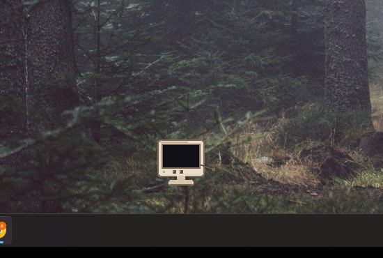
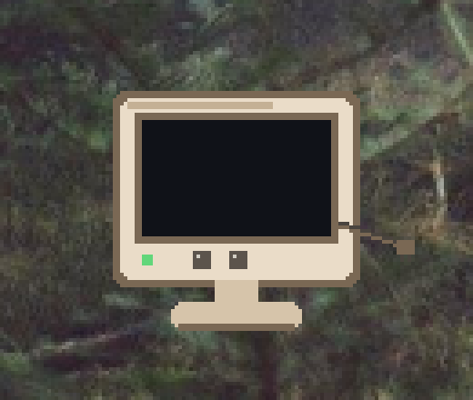

<!-- mcp-name: io.github.Jasdish-Singh/headroom -->

# Headroom

[](https://github.com/Jasdish-Singh/headroom/actions/workflows/test.yml)
[](https://github.com/Jasdish-Singh/headroom/blob/main/LICENSE)
[](https://github.com/Jasdish-Singh/headroom/blob/main/pyproject.toml)

**A quiet watcher for the RAM and disk on your Windows PC.**

Headroom sits in the tray, keeps a small history, and shows what is full. Cleanup is limited to an allowlist. Type YES to delete. Type MOVE to send a reviewed file to the Recycle Bin or to an archive folder.

[Jasdish Singh](https://github.com/Jasdish-Singh). [MIT](LICENSE), 2026.

<p>
  
</p>

## What it does

- Watches RAM, commit charge, page file, and free space.
- Records history and a short report (disk trend, likely leaks, folders that grew).
- Cleans only `user_temp`, `windows_temp`, `chrome_cache`, `edge_cache`, `firefox_cache`, `thumbnail_cache`, and `recycle_bin`. Config cannot add a path.
- Reviews files, duplicate copies, old downloads, and startup programs.
- Serves a page on `127.0.0.1` and a read-only desktop pet, Roomy.
- Exposes a local MCP server. `clean`, `move`, and `startup_disable` return a plan. They do not change the PC.

## Install

The command is `headroom`. Python 3.11 or newer.

**Exe.** `headroom.exe` and `Headroom-Setup` from [GitHub Releases](https://github.com/Jasdish-Singh/headroom/releases) once a release is published. Setup does not clean anything and does not register a logon task.

**winget,** after the manifest is published:

```powershell
winget install JasdishSingh.Headroom
```

The URL and SHA256 in `packaging/winget` are still placeholders.

**pip.** The PyPI name is `headroom-pc`.

```powershell
py -3.12 -m pip install "headroom-pc[tray,mcp]"
headroom status
```

`tray` is the icon. `mcp` is the assistant server.

## Quick start

```powershell
headroom status
headroom top
headroom clean --dry-run
headroom watch
headroom dashboard
```

`headroom watch` takes a sample immediately, then every 30 seconds (slower on battery, faster under pressure). `headroom install` starts it at sign-in. A second watch, dashboard, or pet does not start another copy.

`headroom dashboard` prints and opens `http://127.0.0.1:<port>/?token=...`. Before the first stored sample, the page shows the live reading.

Commands, defaults, and exit codes: [docs/commands.md](docs/commands.md).

## Roomy

Roomy is a small beige monitor. The cord is the tail. It walks a little and changes face with the PC. It cannot clean, move, or delete.

<p>
  
</p>

```powershell
headroom pet
headroom widget
headroom pet --skin midnight
headroom pet --skin tower --lite
```

`headroom widget` is the same pet. Click opens the dashboard. Drag remembers the spot. Right-click: dashboard, report, mute, hide, quit.

Moods, skins, and the frame budget: [docs/roomy.md](docs/roomy.md).

## MCP

`headroom mcp` is a stdio server on this PC. Point a client at the installed exe:

```text
headroom.exe mcp
```

**Claude Desktop** (`claude_desktop_config.json`):

```json
{
  "mcpServers": {
    "headroom": {
      "command": "headroom.exe",
      "args": ["mcp"]
    }
  }
}
```

**Cursor** (`.cursor/mcp.json`):

```json
{
  "mcpServers": {
    "headroom": {
      "command": "headroom.exe",
      "args": ["mcp"]
    }
  }
}
```

**Codex and ChatGPT** (`config.toml`):

```toml
[mcp_servers.headroom]
command = "headroom.exe"
args = ["mcp"]
```

With the pip package on `PATH`, the command is `headroom` and the argument is still `mcp`.

mcp-name: io.github.Jasdish-Singh/headroom

### Quick start with AI

Paste this into Claude, ChatGPT, or Cursor after connecting the MCP server.

```text
You have access to Headroom, a local tool that monitors and protects this PC's RAM and disk.

Start a full health check:
1. Call `status` and tell me current RAM, commit, page file and free disk space in plain English.
2. Call `top` and list the 5 biggest RAM users, saying whether each is normal or worth closing.
3. Call `analyze` and `scan` to find what's taking up disk space, grouped into important, safe to clean, and needs my review.
4. Call `dupes` and `startup_list`, and point out duplicate files and startup apps slowing my PC.
5. Call `changes` and `report` to tell me what changed recently and any trends to watch.

Finish with a short summary: my overall PC health (good / watch / act now), the top 3 things to do, and how much space or RAM each would free.

Rules: only read and explain. If cleanup helps, call `clean`, `move` or `startup_disable` only to show me a plan. Never delete, move or disable anything yourself. I'll approve inside Headroom.
```

The same text is [docs/ai-starter-prompt.md](docs/ai-starter-prompt.md) and the MCP prompt `health_check`. Tool list: [docs/commands.md](docs/commands.md).

## More

- [Commands](docs/commands.md)
- [Roomy](docs/roomy.md)
- [Plugins](docs/plugins.md)
- [Build](docs/develop.md)
- [Publishing](docs/PUBLISHING.md)
