# Roomy

Roomy is a read-only desktop pet. `headroom pet` and `headroom widget` open it. `--skin midnight` is the dark CRT. `--skin tower` is a desktop-case body with the same faces. `--lite` keeps it still and only changes the mood.

Click opens the local dashboard. Drag remembers the spot. Right-click: dashboard, report, mute, hide, quit. There is no cleanup item. The watch tray menu has **Show Roomy**. Set `widget.autostart` in config if sign-in should start the pet next to watch.

Walking is about 7 frames per second. Idle is about 1.5. Hidden, asleep, a fullscreen app, and lite mode do not animate. The sprite sheet loads once. Health comes from the watch snapshot (`watch-stats.json`) when that file is fresh.

`headroom self` prints Roomy against a budget of 30 MB extra RAM and 2% CPU. The watch process is budgeted at 40 MB and 1%.

Dusty means more than 2 GB could be cleaned. Slimy means more than 10 GB. Sparkle follows a cleanup that freed space, or a review move you approved. A dry run does not sparkle.

## Moods

One frame from each row of `src/headroom/pets/roomy.png`, scaled up. Magenta (`#ff00ff`) is the transparent key.

| Power | Happy | Walk | Tired |
| --- | --- | --- | --- |
| 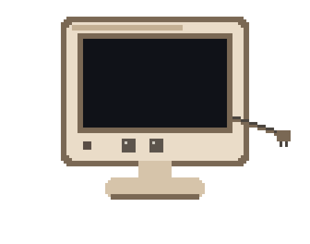 | 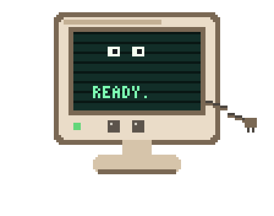 | 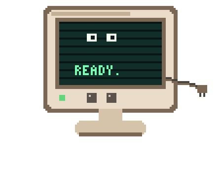 | 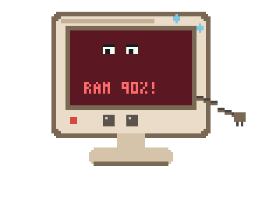 |

| Stuffed | Sleep | Scan | Flicker |
| --- | --- | --- | --- |
| 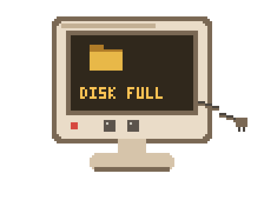 | 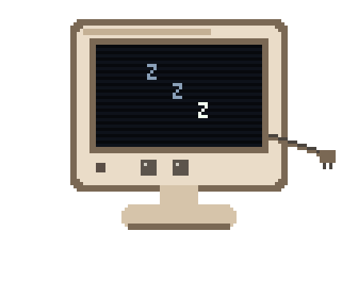 | 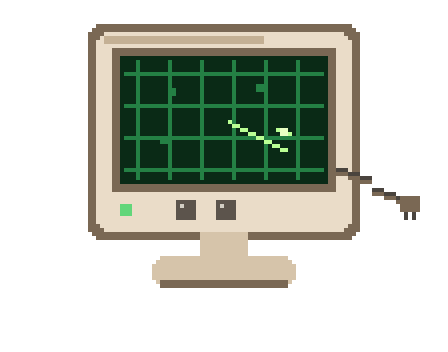 | 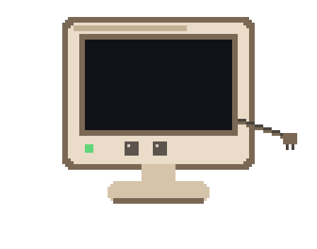 |

| Dusty | Slimy | Sparkle |
| --- | --- | --- |
| 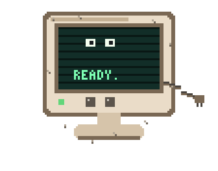 | 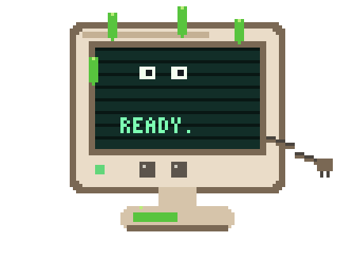 | 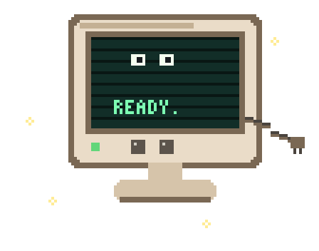 |

Midnight and tower use the same eleven rows. Previews are `docs/images/mood-midnight-happy.png` and `docs/images/mood-tower-happy.png`, and the same pattern for the other moods.

The sheet is 4 columns by 11 rows, each frame 112×88, in this order: power, happy, walk, tired, stuffed, sleep, scan, flicker, dusty, slimy, sparkle. Plugin skins use the same layout. See [plugins.md](plugins.md).
